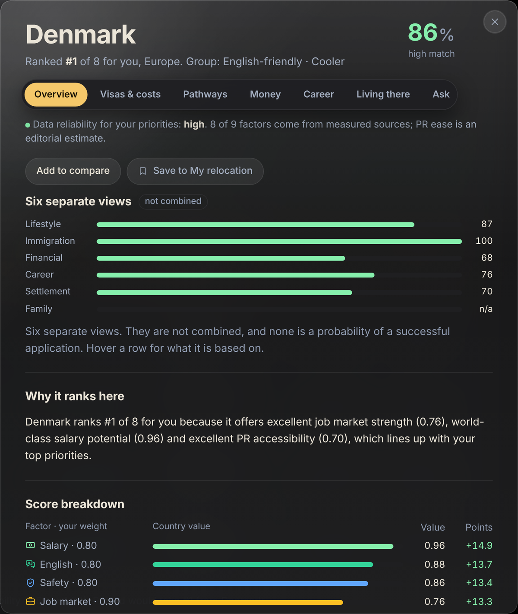
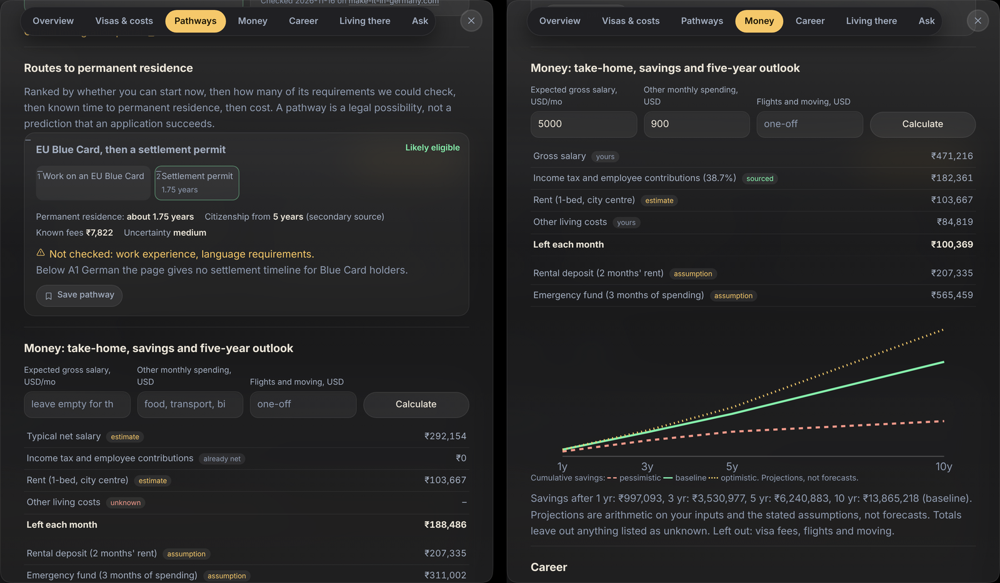
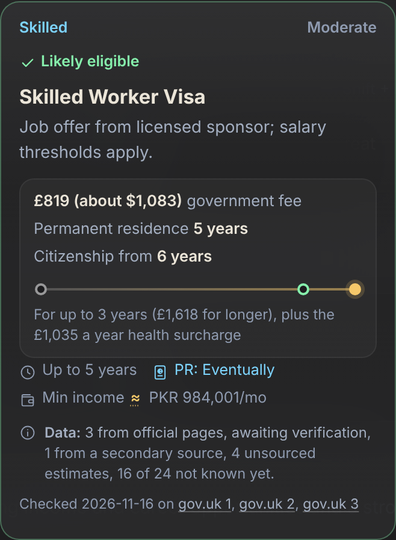
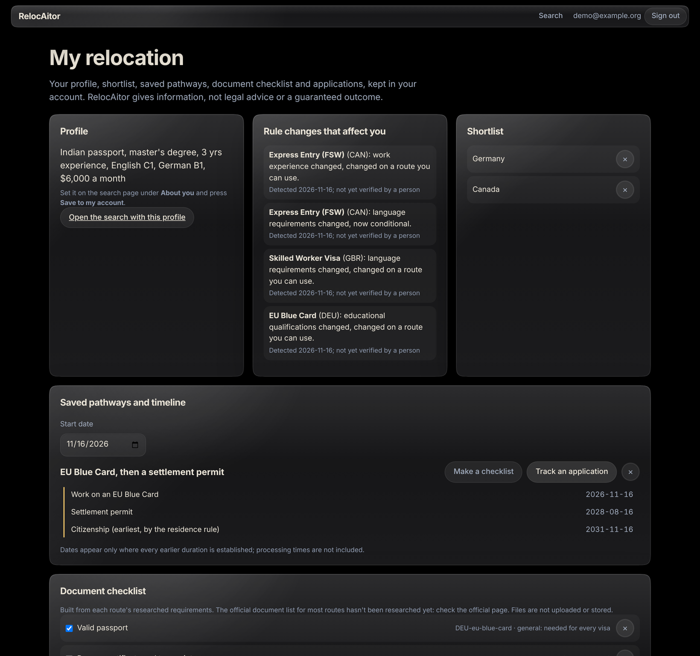
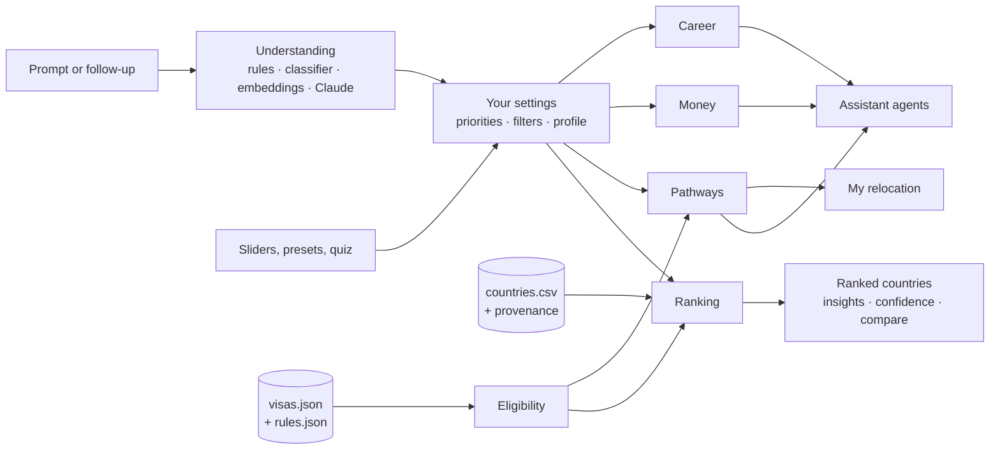

<div align="center">

# RelocAitor

**Find where you can move. Discover how to get there. Build your future anywhere.**

[](https://github.com/zinmeir/relocator/actions/workflows/ci.yml)


[**Live demo**](https://zinmeir.github.io/relocator/) · [Quick start](#quick-start) · [How it works](#how-it-works) · [Docs](docs/) · [API](docs/API.md)


</div>

Describe yourself in plain English, and RelocAitor ranks the countries you could actually move to, checks which visas your passport, money, age, family, job, education and languages unlock, and shows the routes, costs and years to permanent residence and citizenship. Every figure says where it came from.

> *"I'm a Pakistani software engineer earning $3k a month. I want somewhere safe and English-speaking in Europe with a path to PR, cold is fine."*
>
> Then keep talking: *"cheaper"* · *"drop Ireland"* · *"what about Asia?"* · *"why Portugal?"*

## Why it exists

"Best countries to live in" lists rank places for an imaginary average person. A real move mixes soft preferences (safety, climate, cost) with hard rules (which visas your passport and bank balance actually unlock). RelocAitor puts both in one place and shows its working, so you can see why a country ranks where it does and what would change it.

## What it does

<table>
  <tr>
    <td width="22%"><b>Understands you</b></td>
    <td>Rules, a trained classifier, sentence embeddings and optional Claude turn a prompt into priorities, filters and your profile. Follow-ups change only what you mention and report how the ranking moved.</td>
  </tr>
  <tr>
    <td width="22%"><b>Ranks 196 countries</b></td>
    <td>Every UN member plus Taiwan, Hong Kong and Palestine. A transparent weighted score over public data (World Bank, WHO, UNODC, Global Peace Index, EF EPI), with points per factor and the source behind every number.</td>
  </tr>
  <tr>
    <td width="22%"><b>Checks eligibility</b></td>
    <td>117 visa routes and free-movement blocs, checked against passport, income, savings, age, family, job field, education, experience and language level. Each verdict gives the reason, and the exact change that would qualify you.</td>
  </tr>
  <tr>
    <td width="22%"><b>Plans the route</b></td>
    <td>Single and multi-stage routes to permanent residence (study → work → residence), ranked by whether you can start, how much could be checked, time and cost, with what's still unknown.</td>
  </tr>
  <tr>
    <td width="22%"><b>Does the money</b></td>
    <td>Take-home pay after OECD-sourced tax, living and moving costs, and 1/3/5/10-year savings in three scenarios, in your own currency.</td>
  </tr>
  <tr>
    <td width="22%"><b>Looks at your career</b></td>
    <td>Official shortage lists, unemployment, the work visas open to you, and the single steps (English B2, a degree, more experience) that would open more.</td>
  </tr>
  <tr>
    <td width="22%"><b>Answers questions</b></td>
    <td>Agents call these engines; an AI may only reword the result, with your consent, and never with a number the engines didn't produce.</td>
  </tr>
  <tr>
    <td width="22%"><b>Keeps your plan</b></td>
    <td><i>My relocation</i>: an encrypted profile, shortlist, saved pathways with dated milestones, document checklist, application tracker and alerts when a rule change affects you.</td>
  </tr>
  <tr>
    <td width="22%"><b>Is honest about uncertainty</b></td>
    <td>400 what-if scenarios show how stable the ranking is. Every visa figure is marked verified, sourced, estimated or unknown, and unknowns are never filled in.</td>
  </tr>
</table>

## Screenshots

<table>
  <tr>
    <td colspan="2"><b>A conversation.</b> The first message sets everything up; follow-ups nudge it and report what moved.<br></td>
  </tr>
  <tr>
    <td width="50%"><b>Ranked matches</b> with confidence and data reliability<br></td>
    <td width="50%"><b>A country's breakdown</b>: points per factor, sources, what would change it<br></td>
  </tr>
  <tr>
    <td colspan="2"><b>Routes to permanent residence and the money behind them</b>, every line labelled by where it comes from<br></td>
  </tr>
  <tr>
    <td width="50%"><b>Costs and timelines</b> with the official source under every card<br></td>
    <td width="50%"><b>My relocation</b>, with the rule changes that affect you<br></td>
  </tr>
</table>

## Quick start

You need **Python 3.10 or newer**.

```bash
./run.sh          # macOS / Linux: creates a venv, installs, starts, opens http://localhost:5000
./run.sh test     # same setup, then runs the tests
```

On Windows, double-click `run.bat`. Or by hand:

```bash
python -m venv venv && source venv/bin/activate     # Windows: venv\Scripts\activate
pip install -r requirements.txt
python -m ml.build_semantic_index --model-only      # optional, ~90 MB: meaning-based search
python app.py                                       # http://localhost:5000
```

Everything works without API keys. Optional extras are environment variables; see [Deploying](#deploying).

## How it works



- **Ranking.** `score = Σ (wᵢ / Σw) × valueᵢ`. Each value is a country's 0–1 score for a factor (cost inverted), and each term is that factor's points. The match % is min-max scaled across ranked countries, so filtering to one region doesn't inflate it. It is a compatibility score, not a probability of a successful application.
- **Eligibility.** `data/rules.json` holds every visa check as data (which visa field, which profile field, how to compare them, the message). Python and the browser build are two small interpreters of the same file, so a new rule is written once.
- **Reading a prompt.** Four readers in order of trust: rules and vocabulary, a trained classifier, sentence embeddings, then Claude if configured. A later reader only fills gaps, and none can override a negation ("not as a student").
- **How to qualify.** Gaps come from re-running the real rules on a changed profile, not estimates. A test checks that every income lever opens its countries at that amount and not one dollar below.
- **How sure is the ranking.** 400 Monte Carlo scenarios nudge your weights and every data point by its source's reliability, then re-rank: each country's chance of #1, its likely rank range, and which countries are effectively tied.
- **Planning engines.** The pathway optimizer, finance simulator and career module are deterministic code over sourced data. The assistant's agents call them with per-agent permissions, a timeout and retry, and a verification step; an LLM only rewords the result.

The full module map is in [docs/ARCHITECTURE.md](docs/ARCHITECTURE.md).

## Data you can audit

Every visa route reports the same 24 fields (requirements, costs, timelines, rights), and each field carries a status:

| Status | Meaning |
|---|---|
| **Verified** | A named person checked this exact value against the official page |
| **Sourced** | Read from an official page, not yet signed off (AI-assisted research is never more than this) |
| **Third-party** | From a secondary source, such as citizenship rules from Wikipedia's naturalisation table |
| **Estimated** | Curated before sources were recorded, or an editorial rating |
| **Unknown** | Not collected yet: shown as a gap, never guessed |
| **Outdated** | Sourced or verified, but older than that field's freshness window |

Each route has a rule version, and every change is logged with its old and new value. `POST /api/immigration/impact` recomputes a person's eligibility before and after a change. Updates enter only through a reviewed proposal that a person approves by name (`python -m relocaitor.immigration review`, then `approve --by NAME`). Today nothing is verified yet and most requirement fields are unknown; `python -m relocaitor.immigration report` prints the full picture. Details: [docs/IMMIGRATION_DATA.md](docs/IMMIGRATION_DATA.md).

Country scores are generated, not hand-typed. A pipeline downloads public data, scales it with a documented formula, and records the method, source, year and raw value behind each of the 792 numbers in `data/provenance.csv`. Every data file has a JSON Schema, and CI fails on a typo, an impossible value or files that disagree.

| Factor | Built from | Licence |
|---|---|---|
| Salary | GNI per capita (World Bank), log-scaled | CC BY 4.0 |
| Cost of living | Consumer price level: household PPP ÷ exchange rate (World Bank ICP) | CC BY 4.0 |
| Job market | Vulnerable employment + unemployment (World Bank / ILO) | CC BY 4.0 |
| Safety | Homicide rate (UNODC via World Bank) + Global Peace Index 2026 | CC BY 4.0 / cited |
| Healthcare | WHO universal health coverage index + life expectancy | WHO / CC BY 4.0 |
| English | EF English Proficiency Index 2025 (native-English countries = 1.0) | Cited |
| Internet | Internet users, % of population (World Bank / ITU) | CC BY 4.0 |
| Climate | Mean annual temperature of the main city | CC BY-SA |
| Path to residency | Editorial judgement (no public index exists) | — |

<details>
<summary><b>More about the data</b>: whole-world coverage, visa research, tax, currencies, files</summary>

- **The whole world.** `data/world.csv` lists 196 countries with ISO codes from Unicode CLDR. A country is ranked once it has real income data and at least 6 of 9 core indicators. The committed dataset ranks the original 66; `python -m pipeline fetch && python -m pipeline build` (needs internet) brings most of the other 130 in. Gaps are filled only where cross-validation passes (`ml-imputed`, `ml-estimate`) or with a regional median (`regional-median`), all flagged in the data and the UI.
- **Visa research.** `pipeline/visa_details.py` is a research record with an official source and check date for every figure: fees, processing times, years to residence, family rules and age limits for 28 of 117 routes; education, experience and language requirements for UK Skilled Worker, Canada Federal Skilled Worker and Germany's EU Blue Card; shortage lists for Canada, Germany, Ireland and New Zealand; citizenship rules for 62 countries. Research also caught an outdated entry: Germany replaced its Job Seeker Visa with the Opportunity Card in 2024.
- **Multi-stage routes.** `data/transitions.json`: Canada study → post-graduation work permit → Canadian Experience Class; UK student → Graduate visa → Skilled Worker → settlement; Germany Blue Card → settlement permit. Each step links an official page.
- **Tax.** `data/finance/tax_oecd.json`: OECD Taxing Wages 2026, income tax plus employee contributions at the average wage, for 38 countries.
- **Currencies.** ECB daily rates where they exist, otherwise the World Bank's yearly average official rate, for 130 currencies (`python -m pipeline currencies`).
- **Files.** `data/provenance.csv` (source behind every number), `data/SOURCES.md` (every source and licence), `data/raw/` (API downloads), `data/manual/` (published tables, each with its source and date), `data/schemas/` (JSON Schemas, `python -m pipeline.validate`).

```bash
python -m pipeline fetch      # refresh World Bank + WHO data (needs internet)
python -m pipeline build      # rebuild countries.csv, provenance.csv, clusters and SOURCES.md
python -m pipeline check      # fail if countries.csv is out of date with its sources (CI)
python -m pipeline.validate   # every data file against its schema, plus cross-file checks (CI)
python -m relocaitor.immigration check   # immigration records match their sources (CI)
```

</details>

## Machine learning

Machine learning is used where it measurably helps and is kept out of the ranking maths, so the score stays a weighted sum you can audit. Every model is evaluated, a script regenerates its numbers, and tests check that the saved reports match the shipped models.

| Model | Job | Method | Result |
|---|---|---|---|
| Gap filling | Predict missing indicators | Iterative imputation (MICE, Bayesian ridge) | Used only where 5-fold CV R² ≥ 0.5; fills 7 values |
| Country landscape | Map which countries are alike | PCA + k-means | k = 4, silhouette 0.273, bootstrap ARI 0.715 |
| Preference quiz | Learn your weights from choices | Bradley–Terry + active question selection | Spearman ρ 0.785 → **0.896** after 8 questions |
| Prompt classifier | Spot visa routes in free text | TF-IDF + logistic regression | Visa-route accuracy 85.0% → **93.3%** |
| Semantic search | Understand meaning without shared words | all-MiniLM-L6-v2 sentence embeddings | Evaluation script and CI job included |

<details>
<summary><b>1. Gap filling (iterative imputation)</b></summary>

`pipeline/impute.py`. Some sources skip a few countries (the World Bank doesn't list Taiwan, WHO skips Hong Kong). Each missing value is predicted from the country's other indicators. Before trusting it, each indicator is tested with 5-fold cross-validation (hide known values, predict them, measure R²), and it is imputed only if R² ≥ 0.5.

| Indicator | CV R² | Used? |
|---|---|---|
| GNI per capita | 0.96 | Yes |
| WHO UHC index | 0.81 | Yes |
| Price level | 0.81 | Yes |
| Life expectancy | 0.70 | Yes |
| Vulnerable employment | 0.61 | Yes |
| Internet users | 0.61 | Yes |
| Homicide rate | 0.60 | Yes |
| EF English index | 0.38 | No |
| City temperature | 0.36 | No |
| Global Peace Index | 0.32 | No |
| Unemployment | −0.18 | No |

Seven values are ML-imputed (six for Taiwan, one for Hong Kong), which cut editorial fallbacks from 10 to 5. Each is marked `ml-imputed` in `provenance.csv` and shown with ≈ in the UI. *Caveat:* Taiwan's imputed GNI ($19.5k) is probably too low (the real figure is about $34k), because no country in the data resembles Taiwan on every other indicator.

</details>

<details>
<summary><b>2. Country landscape (PCA + k-means)</b></summary>

`pipeline/clusters.py` → `data/ml/country_map.json`. The nine standardised factor scores are projected to 2D with PCA; the axes explain 56% and 15% of the variance and are named after their largest loadings. k-means groups the countries, with k chosen by silhouette over k = 3–8 (k = 4, silhouette 0.273). Re-clustering 30 bootstrap resamples gives a mean adjusted Rand index of 0.715, so the groups are fairly stable but not rigid. A trait only goes in a cluster's name if at least 75% of its members share it.

| Cluster | Countries |
|---|---|
| English-friendly, cooler | 26 |
| Strong job market, little English | 15 |
| Less safe, weak job market | 14 |
| Weaker healthcare, lower income | 11 |

</details>

<details>
<summary><b>3. Preference quiz (Bradley–Terry)</b></summary>

`ml/preferences.py`. The chance of preferring country A over B is a logistic function of the weighted difference between their factor scores. Weights are fitted by MAP estimation with a Gaussian prior centred on balanced weights, using projected gradient descent with a Lipschitz step size, so it always converges. Each next pair maximises *p(1 − p)·‖Δ‖²*: pairs the model is unsure about that also differ a lot.

Evaluated on 200 simulated users with hidden weights and realistic answer noise (`python -m ml.evaluate_preferences`):

| Method | Spearman ρ with true ranking | True top 5 recovered |
|---|---|---|
| Default sliders, no questions | 0.785 | 3.04 / 5 |
| 8 random questions | 0.866 | 3.21 / 5 |
| **8 active questions** | **0.896** | **3.62 / 5** |
| 12 active questions | 0.907 | 3.69 / 5 |

Four active questions (ρ 0.873) do about as well as twelve random ones (ρ 0.882).

</details>

<details>
<summary><b>4. Prompt classifier (TF-IDF + logistic regression)</b></summary>

`ml/train_prompt_model.py`, `ml/prompt_model.py`. Trained on 168 labelled prompts to predict which of the nine factors a prompt asks for and which visa route it implies. Features are word stems, stem bigrams and character 3–4-grams (robust to typos) with sublinear TF-IDF; C = 10 chosen by 5-fold CV. A head is switched on only if it beats the rules by at least one point out of fold.

Held-out test set of 60 prompts written separately from the training data:

| | Factor precision | Factor recall | Factor F1 | Visa-route accuracy |
|---|---|---|---|---|
| Rules only | 0.902 | 0.755 | 0.822 | 0.850 |
| Model only | 0.848 | 0.571 | 0.683 | 0.817 |
| **Rules + model (shipped)** | 0.902 | 0.755 | 0.822 | **0.933** |

The visa head clearly helps, because rules and model make different mistakes. The factor head added only 0.6 F1 points out of fold, below the bar, so it is **switched off**. Inference runs without scikit-learn, in Python and in the browser.

</details>

<details>
<summary><b>5. Semantic search (sentence embeddings)</b></summary>

`ml/semantic.py`. Each text becomes a 384-dimensional vector; similar meanings point in similar directions.

- **Model:** [all-MiniLM-L6-v2](https://huggingface.co/sentence-transformers/all-MiniLM-L6-v2) (22M parameters) through onnxruntime with a built-in WordPiece tokenizer, so the server needs neither PyTorch nor transformers. The static demo runs the same model in the browser with transformers.js.
- **Index:** prototype sentences for each factor and visa route, plus every visa's name, type, country and description, stored as int8 (cosine error under 0.1%).
- **Prompts:** each clause is compared with the prototypes, and a match only fills a gap. Each chip shows the phrase it matched and the similarity.
- **Visa search:** keyword-first hybrid. Name matches keep their order at the top; meaning matches fill the rest.
- **Evaluation:** thresholds tuned on dev data and scored on held-out test data (60 prompts, 20 queries, 7 non-visa prompts). Each part is switched on only if it beats the existing system by at least one point.

```bash
python -m ml.build_semantic_index --download    # model (~90 MB) + corpus vectors
python -m ml.evaluate_semantic                  # writes ml/semantic_eval.json and prints the tables
```

</details>

<details>
<summary><b>Reproducing every number</b></summary>

```bash
pip install -r requirements-dev.txt     # adds scikit-learn and scipy (training only)
python -m pipeline build                # imputation + clusters → data/ml/*.json
python -m ml.evaluate_preferences       # → ml/preference_eval.json
python -m ml.train_prompt_model         # → ml/prompt_model.json, ml/prompt_eval.json
python -m ml.build_semantic_index --download && python -m ml.evaluate_semantic
```

</details>

## All features

<details>
<summary><b>Ask in your own words</b></summary>

- **Meaning, not just keywords:** *"beaches"* → climate, *"low crime"* → safety, *"freelancer"* → digital-nomad visas, *"I want to walk home at night without worrying"* → safety, even with no shared words.
- **Typos:** *"helthcare"*, *"permanant residance"*, *"Portgual"*.
- **Intensity, negation and trade-offs:** *"fast internet is a must"*, *"no snow"*, *"I don't care about salary"*, *"cold is fine"*.
- **Money in any form:** *"$3k/month"*, *"60k a year"*, *"€200,000 to invest"*, *"Rs 500,000 per month"*, *"20 lakh"*.
- **Who you are vs. where you're going:** *"I'm Nigerian living in Dubai, want Canada"* sets the passport to Nigeria and opens Canada. *"Like Portugal but not Spain"*, *"compare Canada vs Australia"* and *"anywhere but Russia or China"* do what they say.
- **Visa search:** *"golden visa"*, *"blue card"*, *"express entry"*, *"D7"*, *"nomad visa in Asia"*. Exact names come first, meaning matches fill the rest.
- Every interpretation is shown as chips with icons, and one click undoes it.

</details>

<details>
<summary><b>Keep talking</b></summary>

*"cheaper"*, *"safer and warmer"*, *"what about Asia?"*, *"drop Japan"*, *"add back Japan"*, *"easier visas"*, *"jobs matter more, forget about salary"*, *"show more"*, *"why Portugal?"*, *"compare the top 3"*, *"undo"*, *"start over"*.

- Relative words nudge a priority from where it is now (±0.25), so "cheaper" twice means cheaper still.
- Each reply re-runs the real ranking before and after: *"Denmark stays #1. New in your top 5: Poland."*
- One chat window with suggestion pills, a typing indicator, a message box that grows as you type, and voice dictation where the browser supports it.

</details>

<details>
<summary><b>Your situation and filters</b></summary>

- **Passport-aware eligibility:** each visa is *Likely eligible*, *Conditional* or *Not eligible*, with the reason.
- **Hard filters, kept separate from preferences:** visa type, must lead to permanent residence, maximum visa difficulty, only countries you likely qualify for, hide your own country.
- **Presets** (Balanced, Digital nomad, Student, Family with kids, Retiree, Career-focused) and an **8-question preference quiz** that learns your weights.
- **Job field:** one of nine fields (or *"I'm a nurse"*). Countries whose official shortage list includes it say so.
- **Age and family:** *"I'm 58"*, *"moving with my wife and two kids"*. Visas with an age limit, or that don't allow a partner or children, say so.
- **Education, experience and languages:** your highest qualification, years of skilled work, and English and German levels (CEFR). The UK Skilled Worker visa needs English B2; the EU Blue Card a degree. Canada's CLB 7 has no official CEFR equivalent, so the app says it can't compare rather than guessing.
- **Money in your currency:** amounts follow your passport's currency (PKR for a Pakistani passport) or any of 130 you pick. Rankings always use dollars.
- **Saved searches** from the bookmark in the top bar. Opening one later re-runs it on today's data and says what moved: *"Since 1 Oct: Portugal is now #1 (was Germany); dropped: Iceland."*

</details>

<details>
<summary><b>Explanations, costs and timelines</b></summary>

- **Score breakdown:** points per factor; hover a row for the source and year behind the number.
- **How to qualify:** each missed visa says exactly why (*"Earn $370/mo more"*, *"Have $50,000 more to invest"*) or that it's passport-restricted.
- **How to open more doors:** *"Earning $2,500/mo (+$500) would also open Croatia, South Korea and Russia."*
- **What would flip #1:** *"If you cared more about affordability (0.50 → 1.00), Poland would take #1 from Denmark."*
- **Costs and timelines** on every researched visa: the government fee in local currency with an approximate dollar figure, the official processing time, and a timeline from applying to permanent residence to citizenship, with the source and check date under each card.
- **Fastest road to a passport:** the quickest researched route you qualify for, with the citizenship rule.
- **Cities:** major cities' temperatures against the scored city, and official price levels where they exist.
- **Six separate views** per country (lifestyle, immigration, financial, career, settlement, family), never added into one number.
- **Ranking confidence, likely rank range and data reliability** on every country; a **similarity map** with machine-learned clusters; **compare** up to three countries; **share** any result by link.

</details>

<details>
<summary><b>Interface and accessibility</b></summary>

- **One set of results, four views:** *Matches*, *Map*, *Compare* and *Explore* tabs over the same results.
- **A short sidebar:** three collapsible groups, each with a one-line summary when closed (*Pakistani passport, healthcare, age 34, with partner and 2 children*).
- **Result cards say one thing at a time:** one status line (*2 visas open*, *field in demand*), and the #1 card adds why it beats #2.
- **Country details** open on the section your search points to (*Overview*, *Visas & costs*, *Pathways*, *Money*, *Career*, *Living there*, *Ask*).
- **Estimates are marked** with ≈ and a tooltip everywhere they appear. **Empty states** offer one button per filter to remove it.
- Pitch-black Liquid Glass design with a light theme; a hand-drawn SVG icon set; iOS-style controls; a swipe-to-dismiss sheet on phones.
- An interactive world map where every country lifts on hover; on a phone a tap shows its card; choosing a region zooms to it.
- Keyboard accessible throughout, including the map (arrow keys step through your ranked countries, announced to screen readers). Visible focus, 4.5:1 text contrast, colour never the only cue, and *reduce motion* and *reduce transparency* honoured.

</details>

## API

JSON in, JSON out; invalid input returns `400 {"error": "..."}`. Every endpoint is documented in [docs/API.md](docs/API.md).

| Area | Endpoints |
|---|---|
| Discover | `POST /api/score` · `/api/insights` · `/api/compare` · `/api/confidence` · `/api/pathways` · `/api/search` · `/api/refine` · `/api/ask` · `/api/preferences` · `/api/visas`, `GET /api/meta` |
| Immigration data | `GET /api/immigration/routes` · `/changes` · `/sources`, `POST /api/immigration/impact` |
| Planning | `POST /api/plan` · `/api/plan/whatif` · `/api/finance/simulate` · `/api/finance/compare` · `/api/career` · `/api/dimensions` · `/api/assistant`, `GET /api/career/jobs` |
| My relocation | `/api/me` · `/profile` · `/shortlist` · `/pathways` · `/timeline` · `/checklist` · `/applications` · `/alerts` · `/export` (session + CSRF token) |

## Testing

```bash
pip install -r requirements-dev.txt
python -m pytest -q --ignore=tests/e2e     # 297 unit, API, ML and parity tests (~70 s)
python -m playwright install chromium      # once
python -m pytest -q tests/e2e              # 39 browser tests (~2 min)
```

The Flask app and the no-server static build give identical answers: a parity test runs 378 requests through both and fails on any difference. GitHub Actions runs the unit tests on Python 3.10 and 3.12, the browser tests in Chromium, the data checks and a real-model semantic job on every push.

<details>
<summary><b>What the tests cover</b></summary>

| Area | What's checked |
|---|---|
| Scoring and eligibility | Weighted sums, free-movement blocs, income, investment, education, experience and language rules, validation and error codes |
| Prompt understanding | 60+ tests over phrasing, typos, negation, money formats, nationalities and country roles |
| Conversation | Nudges from the current value, clamping, "forget about X", exclusions and add-backs, real before/after rankings |
| Reasoning | Exact gaps; every income lever opens at its amount and not one dollar below; deterministic confidence |
| Machine learning | Imputation only where CV passes; deterministic clusters; preference model converges; classifier never overrides rules |
| Semantic search | Tokenizer rules, a real ONNX inference path with a tiny model, int8 accuracy, gap-only behaviour, hybrid ordering |
| Data | Reproducibility, schemas, cross-file agreement, provenance; every visa figure has an official https source; 196 countries with unique codes |
| Immigration records | 24 fields per route; nothing verified without a person and a model can't sign off; values go out of date; changes classified and versioned; proposals blocked without official sources or evidence; robots.txt respected |
| Planning | Multi-stage times by German level; unknowns reported; unchecked routes don't outrank checked ones; what-if reruns the rules; exact finance arithmetic; no invented tax or costs; vacancies off without keys |
| Agents | Routing, tool permissions, profile isolation, AI text rejected when its numbers don't come from the engines, consent respected |
| Accounts | Session and CSRF required; one user can't read or change another's data; profiles encrypted at rest; export and full deletion; rate limits and security headers |
| Browser | The real UI: search, conversation, undo, eligibility, timelines, saved searches, compare, share links, quiz, map keyboard and touch, tabs, currency, pathways, money, career, the workspace, light theme and both static builds |

</details>

## Deploying

| Where | How |
|---|---|
| **Render** | New → Blueprint → choose the repo. `render.yaml` sets the build, health check, a generated encryption key, secure cookies and JSON logs. |
| **Docker** | `docker build -t relocaitor .` then `docker run -p 8000:8000 -v reloc-data:/app/instance -e RELOC_ENCRYPTION_KEY=... relocaitor` |
| **Railway / Heroku-style** | Uses the `Procfile` (`gunicorn app:app`). |
| **GitHub Pages** | Settings → Pages → Source: GitHub Actions. Publishes the static build: search, ranking, map and eligibility in the browser. The planning features and accounts need a server. |

| Variable | Purpose |
|---|---|
| `RELOC_ENCRYPTION_KEY` | Encrypts saved profiles. Keep it stable. |
| `RELOC_DB` | SQLite path on persistent storage (accounts). |
| `RELOC_SECURE_COOKIES=1` | Behind HTTPS. |
| `ANTHROPIC_API_KEY` | Optional: Claude reads prompts and rewords answers (with consent). |
| `ADZUNA_APP_ID`, `ADZUNA_APP_KEY` | Optional: live job vacancies. |
| `RELOC_RATE_LIMIT`, `RELOC_LOG_JSON`, `RELOC_SEMANTIC`, `PORT` | Rate limit, JSON logs, embeddings on/off, port. |

Full checklist: [docs/DEPLOY.md](docs/DEPLOY.md). Security and privacy: [docs/SECURITY.md](docs/SECURITY.md).

<details>
<summary><b>Project structure</b></summary>

```text
relocator/
├── app.py                    Entry point: python app.py · gunicorn app:app
├── relocaitor/               The application package
│   ├── ranking/              Factors, presets, scoring, ranking engine, confidence, explanations, six views
│   ├── nlp/                  Prompt understanding (search), the conversation (refine), Q&A (assistant)
│   ├── visas/                Visa catalogue, eligibility rules, costs and timelines, how to qualify
│   ├── immigration/          Route records, statuses, versions, changes, proposals, monitor (python -m relocaitor.immigration)
│   ├── planner/              Routes to permanent residence, single and multi-stage; what-if
│   ├── finance/              Take-home pay, costs and projections
│   ├── career/               Shortage lists, indicators, skills roadmap; job API connector
│   ├── agents/               The assistant's orchestrator and agents
│   ├── workspace/            Accounts, encrypted profiles, checklist, tracker, timeline (SQLite)
│   ├── web/                  Flask app and routes, input validation, security middleware, icons
│   ├── datasets.py           Loads the country dataset, provenance and the world list
│   └── paths.py              Where data/, static/ and templates/ are
├── ml/                       Semantic search, preference model, prompt classifier, training and evaluation
├── pipeline/                 Data pipeline: fetch → impute → scale → countries.csv; visa research; validation
├── preview/                  No-server build: the API ported to JavaScript
├── data/                     Every dataset and rule file; JSON Schemas in data/schemas/
├── templates/, static/       Pages, CSS and JavaScript
├── tests/                    One folder per package (ranking, nlp, visas, platform, data, ml, web, parity) + e2e
├── docs/                     Architecture, roadmap, status, API, security, deployment, data
└── run.sh, run.bat, Dockerfile, Procfile, render.yaml, .github/workflows/
```

</details>

## Limitations

RelocAitor gives information, not legal advice. **Always confirm with the official immigration authority or a licensed immigration lawyer before acting.**

- **Visa data is incomplete.** No value has been verified by a person yet. Costs and timelines are researched for 28 of 117 routes; education, experience and language requirements for 3. The rest show gaps rather than guesses.
- **Some figures are estimates.** Path-to-residency ease, typical salary and rent are editorial estimates; minimum incomes on most routes have no recorded source. Each is marked as such.
- **Tax is approximate.** One OECD effective rate per country at the average wage, for 38 countries; elsewhere it's left out unless you enter a rate. Projections are arithmetic on stated assumptions, not forecasts.
- **Scores are relative** to the countries currently ranked, and each source measures something slightly different from what a mover cares about (cost is the local price level, internet is access rather than speed, climate is one city).
- **Accounts are basic.** No email verification, password reset or two-factor sign-in yet, and no document uploads (by design for now).

<details>
<summary><b>More limitations</b></summary>

- Citizenship residence periods come from a secondary summary of national laws and assume ordinary naturalisation.
- City data is thin: temperatures for 47 cities and official price levels only for four US metros.
- Points systems aren't modelled. Pathways list what couldn't be checked, and routes checked on passport and money alone rank with conditional ones.
- The noise levels in the confidence simulation are judgement calls: they answer "would a small change flip this?", not "what is the true probability?".
- The scoring model is linear, and some factors are correlated, so they partly double-count (the pipeline reduced salary/jobs correlation from 0.93 to 0.72).
- The classifier was trained on about 170 prompts and the semantic evaluation sets are small, so expect a few points of noise in the metrics. The preference evaluation uses simulated users.
- The static demo re-implements ranking and conversation logic in JavaScript; a parity test keeps them identical, but changes are made twice. The frontend builds HTML from strings and the stylesheet has grown in layers.
- Live vacancies and AI rewording need API keys; without them those parts say so instead of filling in.

</details>

## Roadmap

- [x] Ranking, eligibility, conversation, confidence and ML, with a no-server build and a parity test
- [x] Auditable immigration data: per-field status, versions, change log, proposals, human verification
- [x] Pathways, money, career, six separate views, assistant agents, accounts and My relocation
- [ ] Approve the waiting Germany Blue Card update, then research the remaining routes' requirements, costs and timelines through proposals a person signs off
- [ ] More multi-stage routes (digital nomad, business, family), each from an official source
- [ ] Tax for non-OECD countries and by income band; salary ranges by occupation; city costs outside the US
- [ ] Email verification, password reset, two-factor sign-in and a Content Security Policy
- [ ] A benchmark of real profiles with independently chosen countries, and a user study for the quiz
- [ ] Split `app.js` into modules; move accounts to PostgreSQL when there's more than one server

Status of every part: [docs/STATUS.md](docs/STATUS.md).

## Tech stack

| Layer | Technology |
|---|---|
| Backend | Python, Flask, pandas, NumPy, gunicorn |
| Accounts and security | SQLite, scrypt, Fernet encryption (`cryptography`), CSRF tokens, rate limiting |
| Frontend | Vanilla JavaScript, SVG, CSS backdrop filters and 3D transforms |
| Map | topojson world-atlas, d3-geo |
| Machine learning | scikit-learn (training), NumPy; inference without scikit-learn in Python and the browser |
| Embeddings | all-MiniLM-L6-v2 via onnxruntime (server) and transformers.js (browser) |
| Optional services | Claude (Anthropic Messages API), Adzuna job vacancies |
| Testing and CI | pytest, Playwright, GitHub Actions |

## Credits and licence

Data from the World Bank, WHO, UNODC, the OECD, the ECB, the Institute for Economics & Peace (Global Peace Index) and EF Education First (EF EPI); see [`data/SOURCES.md`](data/SOURCES.md) for every source and licence. Map shapes from [world-atlas](https://github.com/topojson/world-atlas). Sentence embeddings from [sentence-transformers](https://www.sbert.net/).

Released under the [MIT licence](LICENSE). Built by [Muhammad Shaheer Akhtar](https://github.com/zinmeir).
