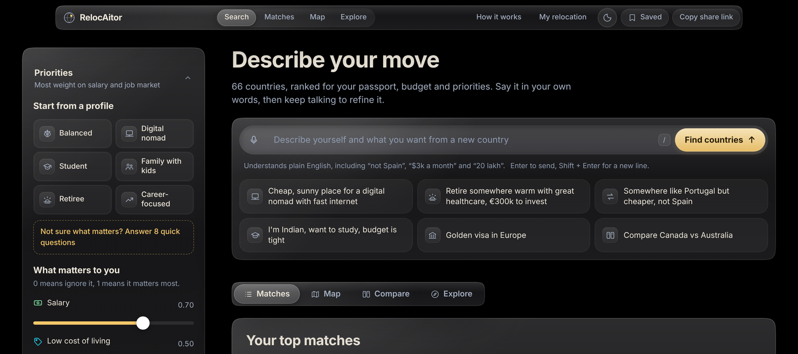
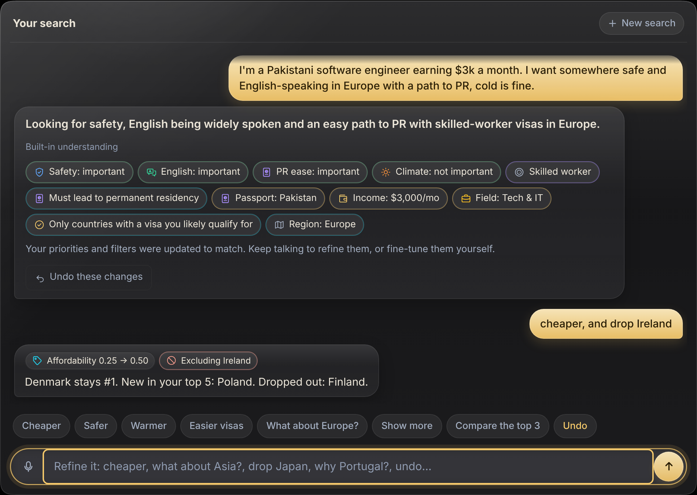
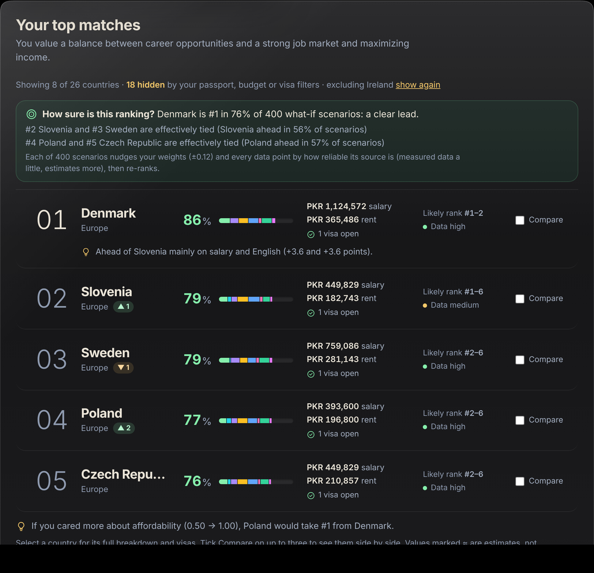
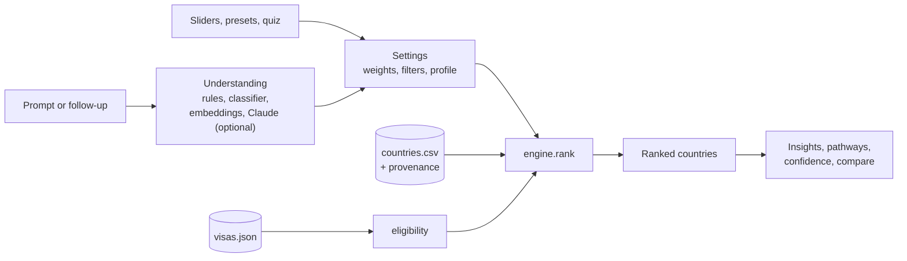

# RelocAitor

**Find the countries you could actually move to, ranked for your passport, your budget and what matters to you.**

[](https://github.com/zinmeir/relocator/actions/workflows/ci.yml)




Describe yourself in plain English (*"I'm a Pakistani software engineer earning $3k a month and want somewhere safe and English-speaking in Europe with a path to PR"*). RelocAitor ranks 66 countries for you, checks each of 117 visa routes against your passport, income and savings, and explains every result. Then keep talking to it: *"cheaper"*, *"drop Ireland"*, *"what about Asia?"*, *"why Portugal?"*.

**Live demo:** [zinmeir.github.io/relocator](https://zinmeir.github.io/relocator/), a single static page that runs entirely in your browser.

---

## Contents

- [Why it exists](#why-it-exists)
- [Highlights](#highlights)
- [Screenshots](#screenshots)
- [Quick start](#quick-start)
- [Features](#features)
- [How it works](#how-it-works)
- [Machine learning](#machine-learning)
- [Data](#data)
- [API](#api)
- [Testing](#testing)
- [Deploying](#deploying)
- [Project structure](#project-structure)
- [Limitations](#limitations)
- [Roadmap](#roadmap)
- [Tech stack](#tech-stack)
- [Credits and licence](#credits-and-licence)

---

## Why it exists

"Best countries to live in" lists rank places for an imaginary average person. Real relocation decisions mix soft preferences (safety, climate, cost) with hard rules (which visas your passport and bank balance actually unlock). RelocAitor puts both in one place and shows its working, so you can see why a country ranks where it does and what would change it.

## Highlights

- **Plain-English search with a real conversation.** A layered reader (rules, a trained classifier, sentence embeddings and an optional LLM) turns a prompt into weights, filters and your profile. Follow-ups change only what you mention, and each reply reports how the ranking moved.
- **Eligibility, not just preference.** Each visa route is checked against your passport, income and savings, including free-movement blocs (EU/EEA, Common Travel Area, Trans-Tasman, GCC, Mercosur).
- **Reasoning you can audit.** The score is a weighted sum shown as points per factor. Every data point records its source and year. The app also tells you the exact change that would qualify you for more visas.
- **Honest uncertainty.** 400 what-if scenarios show how stable the ranking is ("Denmark is #1 in 76% of scenarios"), and which countries are effectively tied.
- **Machine learning with measured results.** Five models, each evaluated on held-out data. One was switched off because it didn't beat the rules, and the README says so.
- **Two runtimes, identical answers.** The Flask app and a no-server static build give identical answers. A parity test runs 335 requests through both and fails on any difference.

---

## Screenshots

**A conversation.** The first message sets everything up; follow-ups nudge it and report what moved.



| Ranked matches with confidence | A country's full breakdown |
|---|---|
|  |  |

---

## Quick start

You need **Python 3.10 or newer**.

**Windows:** double-click `run.bat`.

**macOS / Linux:**
```bash
./run.sh          # create a venv, install, download the embedding model, start, open the browser
./run.sh test     # same setup, then run the test suite
```

**Manually:**
```bash
python -m venv venv
source venv/bin/activate                          # Windows: venv\Scripts\activate
pip install -r requirements.txt
python -m ml.build_semantic_index --model-only    # optional, ~90 MB, enables semantic search
python app.py                                     # http://localhost:5000
```

**Docker:**
```bash
docker build -t relocaitor .
docker run -p 8000:8000 relocaitor                # http://localhost:8000
```

### Configuration

All settings are optional environment variables.

| Variable | Default | Effect |
|---|---|---|
| `ANTHROPIC_API_KEY` | unset | Turns on Claude for prompt reading and Q&A. Without it the built-in models are used. |
| `ANTHROPIC_MODEL` | `claude-haiku-5-5` | Which Claude model to call. |
| `RELOC_SEMANTIC` | `1` | Set to `0` to turn off sentence embeddings (keywords, rules and the classifier still work). |
| `PORT`, `HOST` | `5000`, `127.0.0.1` | Where the development server listens. |
| `FLASK_DEBUG` | `0` | Set to `1` for auto-reload on your own machine. Never on a server. |

---

## Features

### Ask in your own words
- **Meaning, not just keywords:** *"beaches"* → climate, *"low crime"* → safety, *"freelancer"* → digital-nomad visas, *"I want to walk home at night without worrying"* → safety, even with no shared words.
- **Typos:** *"helthcare"*, *"permanant residance"*, *"Portgual"*.
- **Intensity, negation and trade-offs:** *"fast internet is a must"*, *"no snow"*, *"I don't care about salary"*, *"cold is fine"*.
- **Money in any form:** *"$3k/month"*, *"60k a year"*, *"€200,000 to invest"*, *"Rs 500,000 per month"*, *"20 lakh"*.
- **Who you are vs. where you're going:** *"I'm Nigerian living in Dubai, want Canada"* sets the passport to Nigeria and opens Canada. *"Like Portugal but not Spain"*, *"compare Canada vs Australia"* and *"anywhere but Russia or China"* do what they say.
- **Visa search:** *"golden visa"*, *"blue card"*, *"express entry"*, *"D7"*, *"nomad visa in Asia"*. Exact names come first, meaning matches fill the rest.
- Every interpretation is shown as chips with icons, and one click undoes it.

### Keep talking
*"cheaper"*, *"safer and warmer"*, *"what about Asia?"*, *"drop Japan"*, *"add back Japan"*, *"easier visas"*, *"jobs matter more, forget about salary"*, *"show more"*, *"why Portugal?"*, *"compare the top 3"*, *"undo"*, *"start over"*.
- Relative words nudge a priority from where it is now (±0.25), so "cheaper" twice means cheaper still.
- Each reply re-runs the real ranking before and after: *"Denmark stays #1. New in your top 5: Poland."*
- One chat window with suggestion pills, a typing indicator, a message box that grows as you type, and voice dictation where the browser supports it.

### Personalised and filtered
- **Passport-aware eligibility:** each visa is *Likely eligible*, *Conditional* or *Not eligible*, with the reason.
- **Hard filters, kept separate from preferences:** visa type, must lead to PR, maximum visa difficulty, only countries you likely qualify for, hide your own country.
- **Presets:** Balanced, Digital nomad, Student, Family with kids, Retiree, Career-focused.
- **Preference quiz:** not sure what matters? Choose between two real countries eight times and a model learns your weights.

### Explained
- **Score breakdown:** points per factor on every card and in the detail view. Hover a row to see the source and year behind the number.
- **How to qualify:** each visa you miss says exactly why (*"Earn $370/mo more"*, *"Have $50,000 more to invest"*) or that it's passport-restricted.
- **How to open more doors:** *"Earning $2,500/mo (+$500) would also open Croatia, South Korea and Russia."*
- **What would flip #1:** *"If you cared more about affordability (0.50 → 1.00), Poland would take #1 from Denmark."*
- **Ranking confidence, likely rank range and data reliability** on every country.
- **Country landscape:** a 2D similarity map with machine-learned clusters, plus each country's nearest neighbours.
- **Compare** up to three countries side by side, and **ask questions** about any country ("Can I bring my spouse?").
- **Shareable links:** every setting lives in the URL.

### Interface
- Pitch-black Liquid Glass design: translucent panels with an even hairline rim and a pointer-following sheen. The floating navigation bar really refracts the content behind it in Chromium browsers.
- A hand-drawn SVG line-icon set (`icons.py`) instead of emoji, coloured per factor and shared by the server and the browser.
- iOS-style switches, sliders and segmented controls; a swipe-to-dismiss bottom sheet on phones; a Dynamic Island-style toast.
- An interactive world map where every country lifts off on hover. Tiny states (Singapore, Hong Kong, Bahrain, Mauritius) are drawn as dots so all 66 can be clicked.
- Keyboard accessible, works on mobile, and honours *reduce motion* and *reduce transparency*.

---

## How it works



### Scoring

```
score = Σ (wᵢ / Σw) × valueᵢ
```

Each `valueᵢ` is the country's 0–1 value for factor *i* (cost is inverted, because lower is better), and each term is that factor's contribution in points. The match percentage is min-max scaled across all 66 countries, so filtering to one region doesn't inflate it.

The ranking pipeline (`engine.rank`) has four steps:

1. Score all 66 countries.
2. Annotate every visa with your eligibility and whether it passes your hard filters.
3. Drop countries outside your region, your own country, and (if a visa filter is on) countries with no qualifying visa.
4. Rank what's left.

### Reading a prompt

Four readers run in order of trust. A later one only fills gaps an earlier one left, and none of them can override a negation ("not as a student"):

1. **Rules and vocabulary** (`search.py`, `data/search_lexicon.json`): phrasing, typos, negation, money, nationalities and country roles.
2. **Trained classifier** (`ml/prompt_model.py`): visa routes the vocabulary misses.
3. **Sentence embeddings** (`ml/semantic.py`): meaning without shared words. They never set a hard filter, and clauses with negation are skipped.
4. **Claude** (optional, `assistant.py`): reads the prompt into the same structure. If the call fails, the app falls back to the built-in readers and says so.

Follow-ups go through `refine.py`, which changes only the settings a message mentions and reports the before/after ranking.

### How to qualify (`pathways.py`)

For each visa the app measures the gap between you and its requirements: the exact income or savings shortfall, a sponsor requirement, or a passport restriction (unreachable). Levers come from **re-running the real eligibility rules on changed profiles**, not from estimates. A test checks every lever: the countries it names must open at that amount and stay closed one dollar below.

### How sure is the ranking? (`confidence.py`)

A Monte Carlo simulation with 400 scenarios. In each one:

1. every weight moves by up to about ±0.12;
2. every data point moves according to its source in `provenance.csv`: ±0.02 for measured data, ±0.08 for ML-imputed values and editorial estimates, ±0.15 for flagged fallbacks;
3. the countries are re-ranked.

The output is each country's chance of being #1 and of making your top N, its likely rank range (5th–95th percentile), and a verdict: *clear lead*, *likely* or *too close to call*. The random numbers come from mulberry32, so Python and the browser produce bit-identical scenarios.

---

## Machine learning

Machine learning is used where it measurably helps and kept **out of the ranking maths**, so the score stays a weighted sum you can audit. Every model is evaluated, a script regenerates its numbers, and tests check that the saved reports match the shipped models.

| Model | Job | Method | Result |
|---|---|---|---|
| Gap filling | Predict missing indicators | Iterative imputation (MICE, Bayesian ridge) | Used only where 5-fold CV R² ≥ 0.5; fills 7 values |
| Country landscape | Map which countries are alike | PCA + k-means | k = 4, silhouette 0.273, bootstrap ARI 0.715 |
| Preference quiz | Learn your weights from choices | Bradley–Terry + active question selection | Spearman ρ 0.785 → **0.896** after 8 questions |
| Prompt classifier | Spot visa routes in free text | TF-IDF + logistic regression | Visa-route accuracy 85.0% → **93.3%** |
| Semantic search | Understand meaning without shared words | all-MiniLM-L6-v2 sentence embeddings | Evaluation script and CI job included (see below) |

<details>
<summary><b>1. Gap filling (iterative imputation)</b></summary>

`pipeline/impute.py`. Some sources skip a few countries (the World Bank doesn't list Taiwan, WHO skips Hong Kong). Each missing value is predicted from the country's other indicators. Before trusting it, each indicator is tested with 5-fold cross-validation (hide known values, predict them, measure R²), and it is imputed only if R² ≥ 0.5.

| Indicator | CV R² | Used? |
|---|---|---|
| GNI per capita | 0.96 | Yes |
| WHO UHC index | 0.81 | Yes |
| Price level | 0.81 | Yes |
| Life expectancy | 0.70 | Yes |
| Vulnerable employment | 0.61 | Yes |
| Internet users | 0.61 | Yes |
| Homicide rate | 0.60 | Yes |
| EF English index | 0.38 | No |
| City temperature | 0.36 | No |
| Global Peace Index | 0.32 | No |
| Unemployment | −0.18 | No |

Seven values are ML-imputed (six for Taiwan, one for Hong Kong), which cut editorial fallbacks from 10 to 5. Each is marked `ml-imputed` in `provenance.csv` and in the UI. *Caveat:* Taiwan's imputed GNI ($19.5k) is probably too low (the real figure is about $34k), because no country in the data resembles Taiwan on every other indicator.
</details>

<details>
<summary><b>2. Country landscape (PCA + k-means)</b></summary>

`pipeline/clusters.py` → `data/ml/country_map.json`. The nine standardised factor scores are projected to 2D with PCA; the axes explain 56% and 15% of the variance and are named after their largest loadings. k-means groups the countries, with k chosen by silhouette over k = 3–8 (k = 4, silhouette 0.273). Re-clustering 30 bootstrap resamples gives a mean adjusted Rand index of 0.715, so the groups are fairly stable but not rigid. Clusters are named from their centroids, and a trait only goes in the name if at least 75% of members share it.

| Cluster | Countries |
|---|---|
| English-friendly, cooler | 26 |
| Strong job market, little English | 15 |
| Less safe, weak job market | 14 |
| Weaker healthcare, lower income | 11 |
</details>

<details>
<summary><b>3. Preference quiz (Bradley–Terry)</b></summary>

`ml/preferences.py`. The chance of preferring country A over B is modelled as a logistic function of the weighted difference between their factor scores. Weights are fitted by MAP estimation with a Gaussian prior centred on balanced weights, using projected gradient descent with a Lipschitz step size (so it always converges). Each next pair maximises *p(1 − p)·‖Δ‖²*: pairs the model is unsure about that also differ a lot.

Evaluated on 200 simulated users with hidden weights and realistic answer noise (`python -m ml.evaluate_preferences`):

| Method | Spearman ρ with true ranking | True top 5 recovered |
|---|---|---|
| Default sliders, no questions | 0.785 | 3.04 / 5 |
| 8 random questions | 0.866 | 3.21 / 5 |
| **8 active questions** | **0.896** | **3.62 / 5** |
| 12 active questions | 0.907 | 3.69 / 5 |

Four active questions (ρ 0.873) do about as well as twelve random ones (ρ 0.882).
</details>

<details>
<summary><b>4. Prompt classifier (TF-IDF + logistic regression)</b></summary>

`ml/train_prompt_model.py`, `ml/prompt_model.py`. Trained on 168 labelled prompts to predict which of the nine factors a prompt asks for and which visa route it implies. Features are word stems, stem bigrams and character 3–4-grams (robust to typos) with sublinear TF-IDF; C = 10 chosen by 5-fold CV. Thresholds and on/off switches are decided from out-of-fold predictions on the training set only, and a head is switched on only if it beats the rules by at least one point.

Held-out test set of 60 prompts written separately from the training data:

| | Factor precision | Factor recall | Factor F1 | Visa-route accuracy |
|---|---|---|---|---|
| Rules only | 0.902 | 0.755 | 0.822 | 0.850 |
| Model only | 0.848 | 0.571 | 0.683 | 0.817 |
| **Rules + model (shipped)** | 0.902 | 0.755 | 0.822 | **0.933** |

The visa head clearly helps, because rules and model make different mistakes. The factor head added only 0.6 F1 points out of fold, below the bar, so it is **switched off**. On the test set it would have added one false positive and nothing else. Inference runs without scikit-learn, in Python and in the browser.
</details>

<details>
<summary><b>5. Semantic search (sentence embeddings)</b></summary>

`ml/semantic.py`. Each text becomes a 384-dimensional vector; similar meanings point in similar directions (cosine similarity).

- **Model:** [all-MiniLM-L6-v2](https://huggingface.co/sentence-transformers/all-MiniLM-L6-v2) (22M parameters), run through onnxruntime with a built-in WordPiece tokenizer, so the server needs neither PyTorch nor transformers. The static demo runs the same model in the browser with transformers.js.
- **Index:** prototype sentences for each factor and visa route, plus every visa's name, type, country and description, stored as int8 (cosine error under 0.1%).
- **Prompts:** each clause is compared with the prototypes, and a match fills a gap only. Each chip shows the phrase it matched and the similarity.
- **Visa search:** keyword-first hybrid. Name matches keep their order at the top, and meaning matches fill the rest; each result says whether it matched by keyword, meaning or both.
- **Evaluation:** thresholds are tuned on dev data (22 queries plus 8 non-visa prompts) and scored on held-out test data (60 prompts, 20 queries, 7 non-visa prompts). Each part is switched on only if it beats the existing system by at least one point on dev data.

```bash
python -m ml.build_semantic_index --download    # model (~90 MB) + corpus vectors
python -m ml.evaluate_semantic                  # writes ml/semantic_eval.json and prints the tables
```

The CI `semantic` job runs this on every push and uploads the report. Without the model, the app works exactly as before, and the UI says which readers understood each prompt.
</details>

### Reproducing every number

```bash
pip install -r requirements-dev.txt     # adds scikit-learn and scipy (training only)
python -m pipeline build                # imputation + clusters → data/ml/*.json
python -m ml.evaluate_preferences       # → ml/preference_eval.json
python -m ml.train_prompt_model         # → ml/prompt_model.json, ml/prompt_eval.json
python -m ml.build_semantic_index --download && python -m ml.evaluate_semantic
```

---

## Data

Country scores are **generated, not hand-typed**. A small pipeline downloads public data, scales it with a documented formula and records where every number came from.

```bash
python -m pipeline fetch    # refresh World Bank + WHO data into data/raw/ (needs internet)
python -m pipeline build    # rebuild countries.csv, provenance.csv and SOURCES.md (offline)
python -m pipeline check    # fail if countries.csv is out of date with its sources (runs in CI)
python -m pipeline report   # what changed compared with the original hand-made values
```

| Factor | Built from | Licence |
|---|---|---|
| Salary | GNI per capita (World Bank), log-scaled | CC BY 4.0 |
| Cost of living | Consumer price level: household PPP ÷ exchange rate (World Bank ICP) | CC BY 4.0 |
| Job market | Vulnerable employment + unemployment (World Bank / ILO) | CC BY 4.0 |
| Safety | Homicide rate (UNODC via World Bank) + Global Peace Index 2026 | CC BY 4.0 / cited |
| Healthcare | WHO universal health coverage index + life expectancy | WHO / CC BY 4.0 |
| English | EF English Proficiency Index 2025 (native-English countries = 1.0) | Cited |
| Internet | Internet users, % of population (World Bank / ITU) | CC BY 4.0 |
| Climate | Mean annual temperature of the main city | CC BY-SA |
| PR ease | Editorial judgement (no public index exists) | — |

- **`data/provenance.csv`** records the method, source, year and raw value behind each of the 792 numbers, e.g. `ARE, cost_of_living, PRICE_LEVEL(consumption) 2025=0.688`. The app shows it when you hover a breakdown row.
- **`data/SOURCES.md`** documents every column, source and licence.
- **`data/raw/`** holds API downloads; **`data/manual/`** holds published tables with no API, each with its source and retrieval date.
- **`data/editorial.csv`** is used only for PR ease and the salary/rent figures, and as a flagged fallback (currently 5 values).
- Each indicator is clipped to its 5th–95th percentile, then min-max scaled, so one extreme country can't squash the rest.
- **`data/visas.json`** holds 117 visa routes across 66 countries (45 skilled, 28 digital nomad, 18 investor, 8 study, 7 passive income, 6 family, 5 startup), curated from official portals. Each has a type, difficulty, duration, PR route, minimum income and investment, optional passport restrictions and a `last_verified` date. Setting that date shows a verified badge in the UI.

---

## API

| Endpoint | Purpose |
|---|---|
| `GET /` | The app |
| `GET /api/health` | Health check |
| `GET /api/meta` | Factors, presets, regions, visa types, nationalities |
| `POST /api/score` | Ranked countries, profile summary, what would flip #1 |
| `POST /api/insights` | Explanation, breakdown, what-if, trade-offs, visas, similar countries |
| `POST /api/compare` | Up to three countries side by side |
| `POST /api/ask` | A question about one country |
| `POST /api/pathways` | Closest visas you don't qualify for yet, and what would open more countries |
| `POST /api/confidence` | P(#1), P(top N), likely rank range, ties, data reliability |
| `POST /api/preferences` | Quiz answers so far → learned weights + the next question |
| `POST /api/search` | Prompt → weights, filters, profile, matching visas, similar countries |
| `POST /api/refine` | Follow-up + current settings → new settings, changes, ranking movement, actions |
| `POST /api/visas` | Visa lookup by type and difficulty |

POST endpoints accept:

```json
{
  "weights": {"salary": 0.7, "cost": 0.5, "safety": 0.8},
  "region": "Europe",
  "profile": {
    "nationality": "PAK", "monthly_income": 2500, "investment_budget": 50000,
    "visa_type": "nomad", "require_pr": false, "max_difficulty": "Moderate",
    "only_qualifying": true, "exclude_home": true, "exclude_countries": ["USA"]
  }
}
```

Invalid input returns `400 {"error": "..."}`; unknown countries return `404`.

---

## Testing

```bash
pip install -r requirements-dev.txt
python -m pytest -q --ignore=tests/e2e     # 207 unit, API, ML and parity tests (~50 s)

python -m playwright install chromium      # once
python -m pytest -q tests/e2e              # 23 browser tests (~90 s)
```

| Area | What's checked |
|---|---|
| Scoring and eligibility | Weighted sums, free-movement blocs, income and investment rules, validation and error codes |
| Prompt understanding | 60+ tests over phrasing, typos, negation, money formats, nationalities and country roles |
| Conversation | Nudges from the current value, clamping, "forget about X", exclusions and add-backs, real before/after rankings |
| Reasoning | Exact gaps; every income lever opens at its amount and not one dollar below; deterministic confidence |
| Machine learning | Imputation only where CV passes; deterministic clusters; preference model converges; classifier never overrides rules; saved reports match shipped models |
| Semantic search | BERT tokenizer rules, a real ONNX inference path with a tiny test model, int8 accuracy, gap-only behaviour, hybrid ordering |
| Data pipeline | Reproducibility, scaling, fallbacks, provenance, API parsers |
| JS/Python parity | 335 requests, including 160 prompts and 60 follow-ups, must match exactly |
| Browser (Playwright) | The real UI on a live server: search, conversation, undo, eligibility, Q&A, compare, share links, quiz, landscape, mobile sheet, both static builds |

The map's CDN files are replaced with local fixtures, so browser tests run offline and are deterministic. Two extra tests run only when the real embedding model is downloaded. GitHub Actions runs the unit tests on Python 3.10 and 3.12, the browser tests in Chromium, and the real-model semantic job on every push.

---

## Deploying

### Static demo on GitHub Pages (free)
1. Push the repo to GitHub.
2. In **Settings → Pages → Source**, choose **GitHub Actions**.
3. `.github/workflows/pages.yml` runs the tests, builds `dist/index.html` and publishes it on every push to `main`.

The static build runs the whole app in the browser: scoring, eligibility, insights, conversation, Q&A rules and prompt reading are ported to JavaScript. It has every feature except Claude. You can also build it yourself:

```bash
python preview/build_preview.py              # dist/index.html (any static host)
python preview/build_preview.py --artifact   # dist/artifact.html (sandboxed hosts that block fetch)
```

### Full app on a server
`render.yaml`, a `Procfile` and a `Dockerfile` are included.

- **Render:** New → Blueprint → select the repo.
- **Railway / Heroku-style hosts:** they use the `Procfile` (`gunicorn app:app`).
- **Fly.io or any container host:** use the `Dockerfile`.

Set `ANTHROPIC_API_KEY` in the host's environment to turn on Claude.

---

## Project structure

```
relocator/
├── app.py                 Flask routes (thin): parse → engine → JSON
├── engine.py              Ranking pipeline and what-if analysis
├── scoring.py             Weighted scoring, contributions, similarity
├── eligibility.py         Passport, income and investment rules; free-movement blocs
├── visas.py               Visa data, annotated for a profile
├── pathways.py            How to qualify: counterfactual eligibility
├── confidence.py          Monte Carlo ranking confidence and data reliability
├── search.py              Prompt understanding and visa search
├── refine.py              Follow-up conversation
├── reasoning.py           Explanations, trade-offs, profile summary
├── assistant.py           Q&A: built-in rules or Claude
├── icons.py               The SVG line-icon set
├── presets.py, factors.py, validation.py, data.py
├── pipeline/              fetch → impute → scale → countries.csv + provenance; clusters
├── ml/                    Semantic search, preference model, prompt classifier, evaluations
│   └── data/              Labelled prompts, visa queries, concept prototypes
├── data/                  countries.csv, provenance.csv, SOURCES.md, visas.json, lexicon, raw/, manual/
├── templates/index.html
├── static/
│   ├── css/style.css
│   └── js/                app.js (controller), glass.js (materials, sheets), map.js, countries.js
├── preview/               Static build: the API ported to JavaScript
├── tests/                 pytest suites; e2e/ holds Playwright tests and offline map fixtures
├── docs/                  Screenshots
├── run.sh, run.bat, Dockerfile, Procfile, render.yaml
└── .github/workflows/     ci.yml, pages.yml
```

---

## Limitations

**Data**
- Each source measures something slightly different from what a mover cares about. Cost is the price level residents pay (expat rents in Singapore, Hong Kong and Dubai are much higher). Internet measures access, not speed. Climate is one city's annual mean. Job market reflects the whole economy, not your profession.
- PR ease, salary and rent are editorial estimates. Taiwan's imputed income is probably too low.
- Scores are relative to these 66 countries, not the whole world.
- Visa rules change often, and no entry has been individually re-verified yet (`last_verified` is empty). Every country links to its official immigration portal.

**Eligibility and reasoning**
- "Likely eligible" checks only passport, income and savings. Shortage occupations, age limits, education, language tests and points systems aren't modelled, and the UI says so next to every visa list.
- The noise levels in the confidence simulation are judgement calls. They answer "would a small change flip this?", not "what is the true probability?".

**Models**
- The scoring model is linear, and some factors are correlated (salary and cost), so they partly double-count. The pipeline already reduced the overlap (salary/jobs correlation from 0.93 to 0.72, safety/health from 0.86 to 0.49).
- The classifier was trained on about 170 prompts, and the semantic evaluation sets are small, so expect a few points of noise in the metrics.
- The preference evaluation uses simulated users. It shows the method works for consistent answers, not how real people behave.
- With 66 countries, clusters are only moderately separated; the landscape is a guide, not a taxonomy.

**Architecture**
- The static demo re-implements the backend in JavaScript. A parity test keeps them identical, but every change has to be made twice.
- The frontend is vanilla JS that builds HTML from strings, and the stylesheet has grown in layers. That's fine at this size, but components and a consolidated stylesheet would scale better.

**Always confirm with the official immigration authority or a licensed immigration lawyer before acting.**

---

## Roadmap

- [ ] Publish the real semantic-search results (run `ml.evaluate_semantic` and add the tables here).
- [ ] Re-verify each visa against its official source and fill in `last_verified`.
- [ ] Build a small benchmark of real profiles with expert-chosen countries, and report how well rankings match.
- [ ] Run a small user study for the preference quiz.
- [ ] Make one implementation the source of truth (shared rule format or a serverless API for the static build).
- [ ] Consolidate the stylesheet.

---

## Tech stack

| Layer | Technology |
|---|---|
| Backend | Python, Flask, pandas, NumPy, gunicorn |
| Frontend | Vanilla JavaScript, SVG, CSS backdrop filters and 3D transforms |
| Map | topojson world-atlas (public domain), d3-geo |
| Machine learning | scikit-learn (training), NumPy; inference runs without scikit-learn in Python and the browser |
| Embeddings | all-MiniLM-L6-v2 via onnxruntime (server) and transformers.js (browser) |
| LLM (optional) | Claude via the Anthropic Messages API |
| Testing and CI | pytest, Playwright, GitHub Actions |

---

## Credits and licence

Data from the World Bank, WHO, UNODC, the Institute for Economics & Peace (Global Peace Index) and EF Education First (EF EPI); see [`data/SOURCES.md`](data/SOURCES.md) for every source and licence. Map shapes from [world-atlas](https://github.com/topojson/world-atlas). Sentence embeddings from [sentence-transformers](https://www.sbert.net/).

Released under the [MIT licence](LICENSE).

Built by [Muhammad Shaheer Akhtar](https://github.com/zinmeir).
