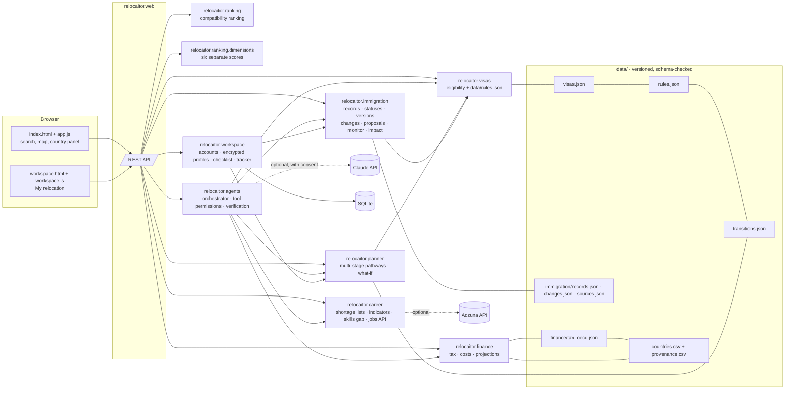

# Architecture

One Flask application (a modular monolith) in the `relocaitor` package. Each box below is a subpackage with one job;
the arrows are the only calls between them. Reference data are versioned JSON/CSV files under schema
validation; user data live in SQLite.

## Boundaries

| Module | Owns | Never does |
|---|---|---|
| `relocaitor/visas/eligibility.py` + `data/rules.json` | Whether a profile meets a route's recorded requirements | Guess a requirement that isn't recorded |
| `relocaitor/immigration/` | What we know about each route, how sure we are, what changed | Mark anything verified without a person |
| `relocaitor/planner/` | Which routes chain to residence; time and cost from known steps | Assume a temporary visa leads to residence |
| `relocaitor/finance/` | Arithmetic over sourced rates, your inputs and stated assumptions | Invent tax rates or living costs |
| `relocaitor/career/` | Official lists, World Bank indicators, rule-based skill gaps | Mix vacancies with statistics or invent jobs |
| `relocaitor/agents/` | Choosing engines for a question, permissions, verification | Let an LLM decide eligibility or compute money |
| `relocaitor/workspace/` | Accounts and personal data | Store documents or share data with third parties |
| `preview/` | The no-server build: `mock_api.js` ports ranking, search and eligibility | Run accounts, pathways, finance, career or agents (they need the server) |

## Two runtimes

The static GitHub Pages build answers ranking, search, eligibility and the immigration data status in the
browser, proven identical to Python by the parity test. The platform features added after Phase 1
(pathways, money, career, dimensions, assistant, accounts) run on the server only; the static build says so
where they would appear.
